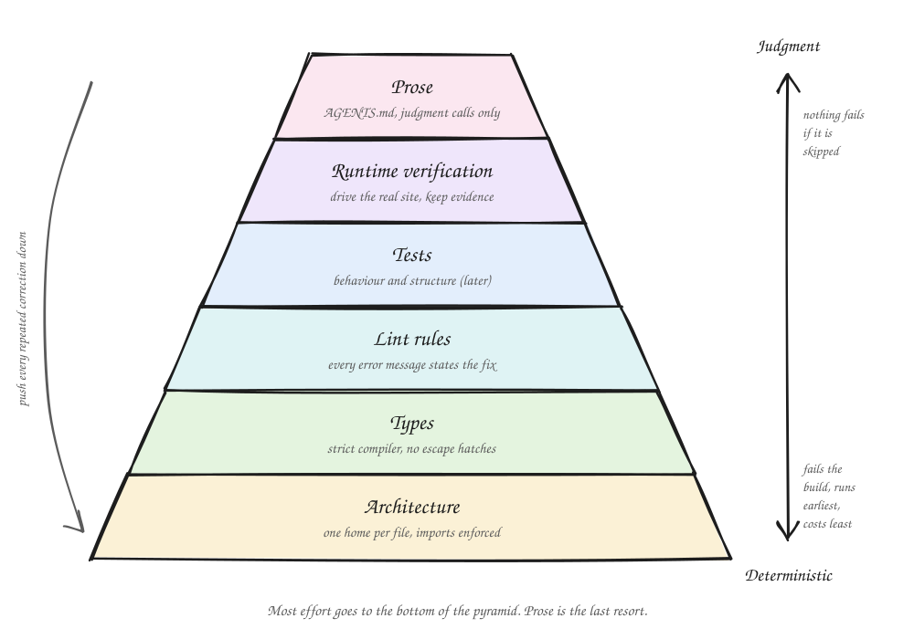

# RFC 0001: Agent-first repository

## Summary

An agent-first repository is one where the cheapest way for an agent to make a change is also the correct way, and where a wrong change fails before anyone reviews it. This RFC orders the ways of achieving that by how deterministic they are. Architecture comes first, then types, lint rules, tests, and runtime verification. Prose instructions come last, for judgment calls only. Most of the effort goes into the bottom layers, because they fail the build, run earliest, and cannot be skipped. Every correction that has to be made twice is pushed down to the lowest layer that can catch it.

## Problem

Coding agents act on three inputs: the files they open, the nearest existing example, and the feedback their tools return. A convention that is not part of one of those inputs is not reliably followed.

Instructions in context files are model context, not constraints. Compliance is not guaranteed, and adherence drops as files grow [[10]](#sources). In a controlled study across several agents, context files did not generally raise task success while raising inference cost by over 20% [[6]](#sources). The same holds for people: static analysis results shown outside the normal workflow go unused, and warnings get ignored [[4]](#sources).

Agents also replicate whatever patterns already exist in a codebase, including poor ones, so every unenforced convention drifts further with each change [[8]](#sources). This repository already shows that drift. Comments, hand-written design values, imports across intended boundaries, and modules in the wrong folder all exist today, and the lint config has no rules that would catch any of them. There is also no single command that defines when a change is done.

## Goals

1. **Mistakes fail before review.** Every convention is enforced by a check at the lowest layer of the pyramid that can express it. Only judgment calls are left to prose.
2. **One command defines done.** A change is finished when `npm run verify` passes with no errors and no warnings.
3. **Feedback arrives during the edit.** Checks report on an edited file within seconds, so a mistake is fixed in the same step that made it.
4. **Checks cannot be switched off from the code.** There are no disable comments, no `@ts-` directives and no type assertions other than `as const`. Every exception is a named override in one config file.
5. **Repeated mistakes stop repeating.** A mistake corrected twice gets a check that fails on it, so the prose layer shrinks over time.

## The priority pyramid

The layers are ordered by how deterministic they are. A lower layer fails earlier, cannot be ignored, and costs less per check. Issues caught at compile time are far more often judged real problems than issues reported later on checked-in code (74% against 21% in one large-scale study), and checks only change behaviour when they block [[4]](#sources). Feedback inside the edit loop measurably improves agent results [[1]](#sources) [[2]](#sources), while prose instructions on their own do not [[6]](#sources) [[7]](#sources).

The rule that follows: solve a problem at the lowest layer that can express it. Move up only when the layer below cannot.

### 1. Architecture

An agent sees only the files it opens and takes the shortest path that compiles, so the shortest path has to be the right one. Architecture gives every kind of module one home and fixes which code may import which, so a misplaced file or a boundary-crossing import fails lint instead of becoming the next example to copy. Structure that is not checked erodes through small, reasonable-looking changes, and agents speed that up by repeating what they see [[5]](#sources) [[8]](#sources).

Design: [RFC 0002: Architecture](0002-architecture.md).

### 2. Types

The compiler is the earliest and most trusted check, but only while nothing can tell it to stop checking. Type assertions and `@ts-ignore` silence it without proving anything, and an agent under pressure to pass a build will use whichever escape is available [[11]](#sources). This layer keeps strict mode on, closes those escapes, and encodes rules such as design scales as types, so invalid values do not compile.

Design: [RFC 0003: Types](0003-types.md).

### 3. Lint rules

Lint covers every convention the type system cannot express. A linter that rejects bad edits measurably improves agent results, and its error message acts as the instruction, so every message names the fix [[1]](#sources) [[2]](#sources). Rules are errors, never warnings, and each one lands with every existing violation fixed, because warnings are ignored and existing code gets copied [[4]](#sources).

Design: [RFC 0004: Lint](0004-lint.md).

### 4. Tests

Tests cover what types and lint cannot see: behaviour, data integrity and file structure. Feedback from tests lets models repair most of the incorrect programs they produce [[3]](#sources). A test that would still pass if the code did nothing proves nothing, so tests check behaviour, not implementation.

Design: [RFC 0005: Tests](0005-tests.md).

### 5. Runtime verification

Static checks cannot show that a page renders or that a diagram responds to its controls. Agents have been observed declaring features finished without running them end to end, and giving them a browser fixed it [[9]](#sources). This layer drives the real site the way a reader would and keeps screenshots as evidence.

Design: [RFC 0006: Runtime verification](0006-runtime-verification.md).

### 6. Prose

Some rules are judgment calls no tool can check, and those go in short `AGENTS.md` files next to the code they govern. Agents follow instructions in context files, but overviews of the repository do not improve results and add cost [[6]](#sources) [[7]](#sources). Nothing fails when an agent skips a prose rule, so a rule lives here only when no lower layer can express it.

Design: [RFC 0007: Prose](0007-prose.md).

## Research

### Sources

1. [Yang et al. 2024, SWE-agent](https://arxiv.org/abs/2405.15793). Peer-reviewed (NeurIPS). A linter that rejects invalid edits raised SWE-bench Lite resolution from 15.0% to 18.0%. Feedback should be informative but concise; guardrails limit error propagation.
2. [Blyth et al. 2025](https://arxiv.org/abs/2508.14419). Preprint. Iterative Bandit and Pylint feedback cut security issues from over 40% to 13% and readability issues from over 80% to 11%. About 5% of iterations introduced a new issue.
3. [Dolcetti et al. 2024](https://arxiv.org/abs/2412.14841). Preprint. Test and static analysis feedback let models repair 62% of incorrect programs and 89% of reported vulnerabilities.
4. [Sadowski et al. 2018](https://research.google/pubs/lessons-from-building-static-analysis-tools-at-google/). Peer-reviewed (CACM), industry. Build-time checks need no effective false positives; review-time checks are disabled above 10%. Checks must be actionable. Warnings are ignored. 74% of compile-time issues judged real against 21% in checked-in code.
5. [Li et al. 2021](https://arxiv.org/abs/2103.11392). Preprint, practitioner study. Architecture erosion is mostly detected through symptoms, with few dedicated tools.
6. [Gloaguen et al. 2026](https://arxiv.org/abs/2602.11988). Peer-reviewed (ICLR). Context files did not generally raise success and added over 20% cost. Instructions were followed; overviews did not help.
7. [Khatri 2026](https://arxiv.org/html/2607.27250v1). Preprint, small sample. No measurable change in correctness across context strategies over 288 runs.
8. [Lopopolo 2026, Harness engineering (OpenAI)](https://openai.com/index/harness-engineering/). Industry report, self-reported. Layered architecture enforced by custom linters and structural tests; lint errors carry remediation; an `AGENTS.md` of about 100 lines; agents replicate existing patterns.
9. [Young 2025, Effective harnesses for long-running agents (Anthropic)](https://www.anthropic.com/engineering/effective-harnesses-for-long-running-agents). Industry report. Agents marked features done without end-to-end testing; browser automation fixed it.
10. [Claude Code memory](https://code.claude.com/docs/en/memory). Official docs. Context files are not enforced; keep each under 200 lines.
11. [TypeScript handbook: type assertions](https://www.typescriptlang.org/docs/handbook/2/everyday-types.html#type-assertions). Official docs. Assertions are removed at compile time; there is no runtime check.

Industry throughput figures (pull request counts, lines of code) are self-reported and are not used as evidence.

### What we learned

1. Feedback in the edit loop improves agent output; instructions alone do not measurably help [1] [2] [3] [6] [7].
2. A check only works if it is actionable, early, and blocking, with near-zero false positives [4].
3. Existing code is part of the prompt, so a rule lands together with the cleanup of every violation [4] [8].
4. Architecture has to be checked mechanically to survive [5] [8].
5. Static checks are not verification of rendered behaviour [9].
6. Context files should be short and instruct rather than describe [6] [8] [10].

## Alternatives considered

- **Prose-only conventions in a long `AGENTS.md`.** Cheapest to write and easy to read. Rejected because nothing fails when an agent ignores it, and controlled studies found no success gain at higher cost.
- **Adopting a published agent plugin or rule set.** Faster to start and maintained elsewhere. Rejected because the available kits target other editors or linters and bring rules for problems this codebase does not have.
- **One large root `AGENTS.md`.** One file to read. Rejected because large context files degrade adherence and local files load only near the work.

## Tradeoffs and risks

- **Strict rules add friction to small changes.** Mitigated by error messages that state the fix.
- **False positives erode trust in checks.** Mature programs disable checks above 10% effective false positives [4]. A rule that misfires gets a narrower selector or a named override in the same change.
- **Claude Code reads `CLAUDE.md`, not `AGENTS.md`.** With `AGENTS.md` only, Claude Code will not load these files by itself; Cursor and Codex do. If this proves a problem, the smallest fix is a root `CLAUDE.md` symlinked to `AGENTS.md`.
