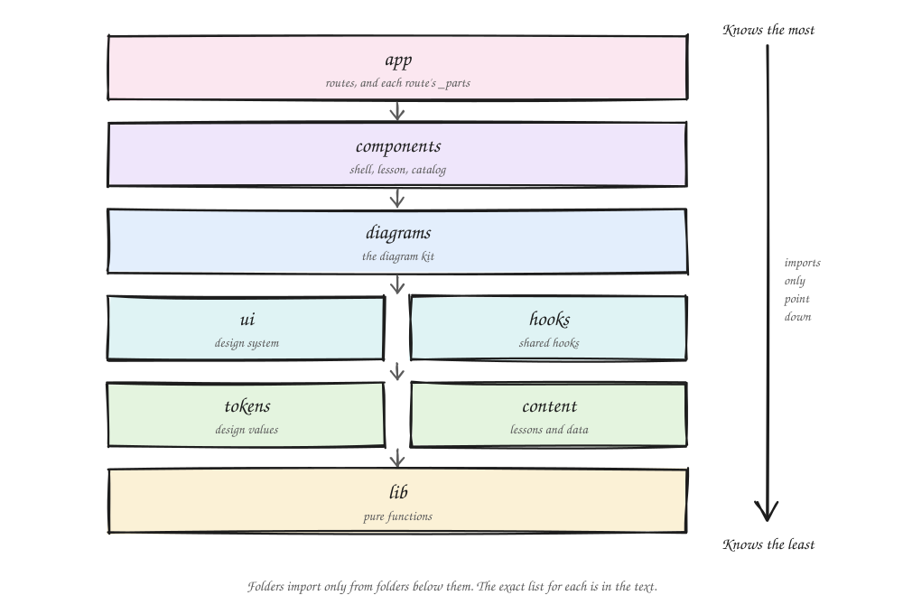

# RFC 0002: Architecture

## Summary

When an agent adds a file, it decides where the file goes by looking at what is already there and copying the nearest example. If the repository has no rules for where code lives and what may import what, every one of those decisions is a fresh guess, and the guesses drift further apart with each change. People then lose the ability to predict where anything is, and the codebase becomes harder to change safely.

This RFC gives every kind of module one home and fixes the direction imports may point. Code starts next to the one place that uses it and moves to a shared folder only when a second place needs it. Folder and file names say what a module is, so there are no catch-all folders or barrel files. Each rule is enforced by lint or by a structural check, because a rule that lives only in prose is not followed [[3]](#sources) [[11]](#sources).

## Problem

Architecture here means two things: where each piece of code lives, and which code is allowed to import which. Software architecture erodes when actual structure drifts from intended structure. The drift comes from many small changes that each look reasonable, it is usually noticed only through symptoms, and few tools detect it [[2]](#sources). Agents speed it up because they replicate whatever patterns already exist, including poor ones [[3]](#sources).

### Code without a fixed home

When there is no rule for where a kind of module goes, the same kind of module ends up in several places. That costs in three ways.

- **Runtime behaviour.** A helper that cannot be found gets written again. The two copies then diverge, and a fix applied to one leaves the bug in the other.
- **Agents.** An agent places a new file next to whatever it read last. One misplaced file becomes the example the next file copies, so a single exception turns into a pattern.
- **People.** A reader who cannot predict where something lives has to search for it, and cannot tell from a file's location what it is allowed to depend on.

The repository already shows this. `src/components` holds page parts used everywhere, sections used only by the homepage, hooks that read and write browser storage, and an inline script, all in one flat folder. The `/foundations` route keeps its sixteen modules directly beside its `page.tsx`, where they are indistinguishable from route files.

### Imports that can point anywhere

A module hides a design decision from the rest of the system, so that when the decision changes, only that module changes [[1]](#sources). That only works if dependencies point one way. When a design-system button can import lesson data, a change to lesson data can break the button, and the button can no longer be understood on its own.

- **Runtime behaviour.** Two-way dependencies create import cycles. In JavaScript a cycle can leave a value `undefined` at the moment it is read, which fails at runtime, not at compile time [[9]](#sources).
- **Agents.** An agent takes the shortest import path that compiles. Without a rule, the shortest path is often across a boundary.
- **People.** With no direction, a reviewer has to check every new import by hand to see whether it couples two parts that should stay separate.

### Catch-all folders and barrel files

A folder named `utils`, `helpers` or `shared` describes nothing about its contents, so it accepts anything, and the cost of placing a module there is zero. Over time it fills with unrelated code that nothing owns.

A barrel file is an `index.ts` that re-exports everything in a folder, so other code can import from the folder instead of the file. Barrels have three costs:

- **Build and dev speed.** Importing one name through a barrel loads every module the barrel re-exports. In one Next.js project, pages loaded over 11,000 modules and took 5 to 10 seconds to start; removing most internal barrels cut that to about 3,500 modules [[9]](#sources). Next.js added a dedicated optimisation for third-party barrels after measuring 15% to 70% faster development builds without them [[8]](#sources).
- **Hidden cycles.** A file that imports a sibling through its own folder's barrel imports itself indirectly [[9]](#sources).
- **No privacy.** A barrel makes everything in a folder look public, so internal helpers get imported from outside [[9]](#sources).

### Shared code created too early, or too late

Code placed in a shared folder before a second user exists is a guess about reuse, and it moves the code away from the one place that explains it. Code left beside one route after a second route starts importing it becomes a hidden dependency between two routes. Keeping code as close as possible to where it is used, and moving it only when that changes, keeps both mistakes visible [[10]](#sources).

### Tests without a fixed home

Tests drift the same way code does. Without a rule, each test ends up wherever its first author put it: beside its file, in a `tests/` folder, or in a `__tests__` folder one level up. An agent about to change a module then cannot find that module's tests, so it does not run them, and it writes a new set in yet another place. Test helpers drift too: a fixture built for one test gets imported by production code, or copied into a second test folder where it goes out of date.

## Goals

1. **Every file has exactly one valid location.** Given what a file is and who imports it, the placement rules in this RFC name one folder. Measured by a structural check that fails on any file in `src` outside an allowed path.
2. **Imports only point down.** Any import that breaks the direction in part 1 fails `oxlint`. Measured by zero violations on a clean checkout.
3. **No catch-all names and no barrels.** Zero files or folders in `src` named `utils`, `helpers`, `common`, `misc` or `shared`, and zero `index.ts` files.
4. **Route-only code lives with its route.** Every module imported by one route sits in that route's `_parts/` folder. Every module imported by two or more routes sits in `src/components`.
5. **One supported way to do each task.** Base UI is imported only in `src/ui`, `next/link` only in `src/ui/Link`, Lucide only in `src/ui/Icon`, and `localStorage` only in `src/hooks`. Each is enforced by lint.
6. **New modules start in the right place.** Every repeated addition (primitives, lessons, diagrams, pages, lint rules, RFCs) and every promotion out of `_parts/` is done by a generator command, so its location, names and registration are never written by hand.
7. **Files stay small enough to read whole.** No file in `src` passes 200 lines and no function passes 60, outside the named data files. Measured by `max-lines` and `max-lines-per-function` at zero violations.
8. **Every test has one home.** Every unit, integration and component test sits beside the file it tests and shares its name, every end-to-end test sits in `e2e/`, and no production file imports a test, a fixture or `src/testing`. Measured by the structural check and lint at zero violations.

## Proposal

The parts are ordered by how much each one prevents. The import direction comes first because it is fully enforced by lint and stops the most damaging kind of drift, coupling between parts that should stay separate. Fixed homes come next, because they decide where each file goes. Colocation and naming refine those homes, and the same rules then place tests. Wrappers and generators make the correct path the easiest one. Enforcement closes the RFC.

### 1. Layers and import direction

A layer is a top-level folder in `src` with one role. Layers are stacked by how much of the application each one knows about. Code may import from layers below it and never from layers above, so a lower layer can always be understood, and changed, without reading anything above it [[1]](#sources) [[6]](#sources) [[7]](#sources).



From the bottom up:

- **`lib`**: pure functions with no React and no knowledge of this site. Imports nothing in `src`. It is at the bottom so anything can use it without pulling in anything else.
- **`tokens`**: design values, meaning colours, type, spacing and motion. Imports nothing in `src`. Every visual decision is stored once here, so it sits below everything that draws.
- **`content`**: the catalog, lesson files, glossary, and the functions that query them. May import `lib`. It knows what the site teaches but nothing about how it looks.
- **`ui`**: the design system, generic controls with no knowledge of lessons or routes. May import `tokens`, `lib`, Base UI and Lucide. Keeping it ignorant of the app is what lets it be reused and reviewed on its own, on `/foundations`.
- **`hooks`**: hooks shared by two or more modules, including every read and write of browser storage. May import `content` and `lib`.
- **`diagrams`**: the diagram kit. May import `tokens`, `ui`, `lib` and `hooks`.
- **`components`**: page parts shared by two or more routes. May import every layer above this line.
- **`app`**: routes and Next.js special files. May import everything. A route's `_parts/` folder may be imported only by that route.

Two files sit outside the layers because Next.js requires their location: `src/mdx-components.tsx` and the special files inside `app`. Each is a named exception in the lint config.

### 2. One home for each kind of module

```
src/
  app/                 Routes and Next.js special files
    <route>/_parts/    Modules used by that one route
  components/          Page parts shared by two or more routes
    shell/             The frame around every page
    lesson/            Parts of a lesson page
    catalog/           Cards, indexes and thumbnails that list lessons and diagrams
  diagrams/            The diagram kit and its animation hooks
  ui/                  Design system controls
  hooks/               Shared hooks, one per file
  content/             Data and the functions that query it
    lessons/<slug>/    One lesson: its MDX and its diagrams
  tokens/              Design values
  lib/                 Pure functions
  testing/             Test helpers and fixtures shared by two or more test folders
e2e/                   End-to-end tests, one file per user journey
lint/                  Local lint rules
scripts/               Repository scripts, such as screenshots and generators
rfc/                   Decisions
```

`components` is split by area because a flat folder stops telling the reader anything once it passes a couple of dozen files, and because the area names say which page each part belongs to. The three areas match how the site is built: the shell around every page, the parts of a lesson, and the parts that list lessons and diagrams.

Areas come from how modules are used, not from a decision made in advance, so the repository can tell when a new one is needed. An area is defined by the routes that use its modules: `shell` holds modules used by every route, `lesson` holds modules used only by lesson routes, and `catalog` holds modules used by the routes that list lessons and diagrams.

- **Placing a promoted module.** When a module leaves `_parts/`, the `promote` generator (part 7) looks at which routes import it and moves it into the area whose routes match.
- **Creating an area.** If no existing area matches, the module waits for company. Once three promoted modules share the same set of importing routes that no area covers, `promote` creates a new area for them, named after what those routes have in common. Three is the threshold because one or two modules are a coincidence, while three are a pattern worth a folder.
- **Splitting an area.** An area that grows past about fifteen files has stopped describing its contents. The structural check reports it, along with any module whose importers no longer match its area, and the fix is to split the area by the same rule.

Folders under `app` that are not routes start with an underscore. Next.js treats an underscore folder as private and never turns it into a URL, so route-only code can sit beside its route safely [[5]](#sources).

### 3. Colocation and promotion

Code starts as close as possible to the one place that uses it, and moves out only when a second place needs it [[10]](#sources).

- **A module used by one route** lives in that route's `_parts/` folder. When a second route imports it, it moves to `components/<area>` in the same change. Because `_parts` may only be imported by its own route, the second import fails lint until the move is made, so the promotion cannot be forgotten.
- **A hook used by one component** stays in that component's file. When a second module needs it, it moves to `src/hooks` as `useThing.ts`. Animation hooks live in `src/diagrams`, because nothing else should animate.
- **A lesson's diagrams** live in that lesson's folder. A diagram reused by a second lesson moves into the kit.
- **New work adds files** instead of editing shared ones. A lesson is a folder, and whether it is written is derived from its MDX file existing, not from a flag kept in sync by hand [[11]](#sources).

#### When to split a file

Colocation says where code goes; it does not say how much belongs in one file. A file that does several things is hard to read, and it is also hard for an agent to edit. In one controlled study, an agent that viewed files 100 lines at a time solved more tasks than the same agent shown whole files (18.0% against 12.7%), and showing too little, 30 lines, also hurt (14.3%) [[21]](#sources). Code that fits in one screen is code an agent can see all of at once.

The rule is the one React gives for components: each one should be concerned with one thing, and when it grows, it is decomposed into smaller pieces [[20]](#sources). That is the same idea as hiding one decision per module [[1]](#sources). In practice:

- **Keep it in the file** when a piece is small, used only by the file's main component, and has no state of its own. A row, a label or a list item that exists to make the main component read clearly stays as an unexported function in the same file, below the main component.
- **Extract a subcomponent in the same file** when a block of JSX has a name of its own in the design, repeats, or nests deeper than the limit below. Naming the block makes the main component read as an outline of the page.
- **Move it to its own file** when it has its own state, Effects or hooks, when another module needs it, or when the file passes the size limit. A file exports one component, named after the file, so moving a piece out is how it becomes reusable.

The limits are enforced by lint, so the decision does not rely on judgment:

- **`max-lines`**: 200 lines per file, not counting blank lines. Data files in `src/content` are exempt by name, because a catalog of 83 lessons is long by nature.
- **`max-lines-per-function`**: 60 lines per function, which keeps every component and hook to about one screen.
- **`react/jsx-max-depth`**: 5 levels of nested JSX. Deeper markup is a sign that a block deserves a name.
- **`complexity`** at 10, **`max-depth`** at 3 and **`max-params`** at 3: functions with many branches, deep nesting or long argument lists are split or given an options object.

When a limit fails, the error message says to extract the largest named block into a subcomponent, so the fix is mechanical.

### 4. Names that say what a module is

- **`PascalCase.tsx`** exports one component named after the file. **`camelCase.ts`** is any other module. A file can then be found from the name of the thing it exports.
- **No catch-all names.** No file or folder is named `utils`, `helpers`, `common`, `misc` or `shared`. A helper is named after what it does and placed in the layer it belongs to.
- **No barrel files.** Every import names the file it comes from. This keeps imports fast, keeps cycles visible, and keeps modules that are not imported from outside effectively private [[8]](#sources) [[9]](#sources).

### 5. Where tests live

Tests are code, so they follow the same placement rules as code: each kind has one home, it starts next to what it checks, and its name says what it is.

The kinds of test (unit, integration, component and end-to-end) differ in how much of the system they run. That difference decides where each one lives: a test that checks one file sits beside that file, and a test that checks a whole journey through the product sits outside `src`, because no single file owns it.

#### Unit, integration and component tests

- **Beside the file they test, with the same name.** `src/content/catalog.ts` is tested by `src/content/catalog.test.ts`, a route handler `route.ts` by `route.test.ts`, a component `MarkAsRead.tsx` by `MarkAsRead.test.tsx`, and a lint rule `lint/rules/noEnum.mts` by `lint/rules/noEnum.test.mts`. The suffix names the kind of file: `.test.ts` runs in Node, `.test.tsx` runs in a real browser. This is the convention across language ecosystems: Go puts each `_test.go` file in the directory of the package it tests, Rust keeps unit tests in the file they test, and Angular's style guide puts each spec in the same folder as its code and advises against a separate tests folder [[22]](#sources) [[23]](#sources) [[24]](#sources).
- **Why beside, not in a mirror tree.** A test beside its file is found without searching, moves with the file when it is promoted, and is deleted with it. A separate `tests/` tree that mirrors `src` has to be kept in step by hand, and it drifts the same way any duplicated structure does [[10]](#sources).
- **A test belongs to its file's layer.** It follows the import rules of the folder it sits in, so a test in `src/lib` can import only what `src/lib` can. A test that needs a higher layer to set up is a sign that the code under test reaches above its layer.
- **Nothing imports a test.** Production code never imports a `.test` file. Test files are leaves of the import graph.
- **Inside `app`, tests sit beside their route.** Next.js turns only special files such as `page.tsx` and `route.ts` into URLs, so a `route.test.ts` beside `route.ts` is never served [[5]](#sources).
- **Integration tests use the same rule.** An integration test runs several real parts together, but it is still about one entry point, such as one route handler or one API client, and sits beside it.

#### End-to-end tests

End-to-end tests live in a top-level `e2e/` folder, one file per journey, named after what the user does: `e2e/readLesson.e2e.ts`.

- **Why outside `src`.** A journey starts on one route and usually crosses several, so there is no single file for it to sit beside. It also tests the built application from outside, through a browser, and imports nothing from `src`. Rust puts its integration tests, which use a crate only through its public interface, in a top-level `tests/` folder for the same reason [[23]](#sources).
- **Why a separate suffix.** The browser runner is pointed at `e2e/` and matches only `.e2e.ts`. Its default pattern matches every `.test` and `.spec` file [[25]](#sources), which would pull in unit tests. The suffix also tells a reader which runner owns the file and that it is slow.
- **Imports.** An end-to-end test may import other files in `e2e/` and nothing in `src`. If a journey needs data, it reads it through the page, the way a user does.

#### Test helpers and fixtures

A fixture is data or setup a test needs: a saved API response, a function that starts a test database, or request handlers for a network mocking tool. Fixtures follow the colocation rule in part 3.

- **A fixture starts beside the one test that uses it**, named `<name>.fixture.ts` or `<name>.fixture.json`, so it is visibly test-only.
- **When a second folder needs it, it moves to `src/testing/`.** `src/testing` is not a layer in the import stack. It may import any layer, and only test files may import it.
- **Production code never imports a fixture or `src/testing`.** Lint fails on such an import, so test-only code cannot leak into the build.

#### Generators create the first test

A generator that creates a module with logic of its own, such as a lint rule or a check script, also creates its test file beside it, with one accepted and one rejected case to fill in. The first test then starts in the right place with the right name, and the next one copies it.

### 6. One supported way to do each task

When the same job can be done two ways, agents use both, and the codebase carries two behaviours where there should be one. For each common task there is one module that does it, and the underlying library is imported nowhere else:

- **Links** go through `src/ui/Link` or `ButtonLink`, never `next/link` directly, so every link gets the same styling and focus behaviour.
- **Base UI** is imported only inside `src/ui`. Everything else uses the wrapped control.
- **Icons** render through `<Icon>`, so stroke width and size come from one place.
- **Browser storage** is read and written only in `src/hooks`, so each stored value has exactly one writer and one format [[11]](#sources).

### 7. Generators

A generator is a command that creates the files for a new piece of the codebase, in the right place, with the right names and the agreed shape, and wires them into anything that needs to know they exist. It turns "the right way" into "the easiest way" to add a file [[17]](#sources). Rails, Nx and Plop all ship generators for this reason: to keep new code consistent with existing conventions without anyone hunting for the current best example [[16]](#sources) [[17]](#sources) [[18]](#sources).

#### Why a generator beats a code snippet in Markdown

The usual alternative is a snippet in an `AGENTS.md` file or a README: "to add a primitive, copy this". A snippet has four weaknesses that a generator does not.

- **A snippet is never checked.** Nothing compiles or lints the code inside a Markdown file, so it drifts from the real code the same way comments do. Comments change with their code in only 13% to 20% of commits [[19]](#sources). A generator's templates are real source files, so the type checker and linter fail the moment a convention changes and the template no longer matches it.
- **A snippet is a suggestion.** An agent reads it, adapts it, and gets some details wrong, such as the folder, a file name, or a registration step. A generator produces the same output every time. Scaffolding is deterministic work, and it is cheaper and more reliable to keep it out of the model entirely [[15]](#sources).
- **A snippet costs context on every task.** Instruction files are loaded whether or not the task needs them, and longer context files raise cost without raising success [[12]](#sources). A generator costs nothing until it runs.
- **A snippet covers one file.** Most additions here touch several places: the new file, an index that lists it, and a page that shows it. A snippet cannot do the second and third steps; a generator does all of them in one command.

#### What generators are for

A task suits a generator when it is repeated, when its output follows a fixed shape, and when it touches more than one place. Creating new modules, registering them in a list, and moving a module to a new home all fit. A task does not suit a generator when each instance is mostly new logic, such as the body of a diagram or the text of a lesson. The generator creates the frame; the agent or author fills it in.

#### Generators in this repository

- **`new:primitive Name`** creates `src/ui/Name.tsx`, wrapping Base UI with styles from tokens and a named export, and adds a section for it on `/foundations` so every state is visible for review.
- **`new:lesson slug`** creates `src/content/lessons/slug/index.mdx` with the lesson's required sections. The lesson counts as written because the file exists, so nothing else needs editing.
- **`new:diagram slug Name`** creates a diagram in the lesson's folder, already using the kit's frame, transport controls and reduced-motion handling, and adds it to the diagram index.
- **`new:page route`** creates `src/app/route/page.tsx` inside the shared page shell, with metadata filled in.
- **`new:rule name`** creates a local lint rule in `lint/rules/`, registers it in `lint/plugin.ts`, and adds it to `oxlint.config.ts` at `error`.
- **`new:rfc slug`** copies the RFC template to the next free number.
- **`promote path area`** moves a module from a route's `_parts/` folder to `components/<area>` and rewrites every import, which is the step part 3 requires when a second route needs it.

Generators live in `scripts/`, and their templates are ordinary `.ts` and `.tsx` files checked by the same type checker and linter as the rest of the code. When a convention changes, its generator changes in the same commit, so new code never starts from an old pattern.

### 8. Enforcement

Every rule above is checked by a tool. Describing the structure in prose does not make agents follow it [[12]](#sources); failing the build does [[3]](#sources) [[4]](#sources).

- **Import direction and wrappers** use `no-restricted-imports` in one override per layer in `oxlint.config.ts`, as defined in RFC 0004. Each error message names the layer the import should come from or the wrapper to use. The same approach is used by published React architecture guides with `import/no-restricted-paths` [[7]](#sources).
- **File names** use `unicorn/filename-case`, with named overrides for Next.js special files.
- **File and function size** use `max-lines`, `max-lines-per-function`, `react/jsx-max-depth`, `complexity`, `max-depth` and `max-params`, as set out in part 3.
- **Barrels and catch-all names** are reported by a small local rule that checks the file path.
- **Placement** is checked by the structural check. Its failure message says where the file belongs.
- **Test placement** is checked by the structural check, which fails on a `.test` file with no source file of the same name beside it and on an `.e2e.ts` file outside `e2e/`. Lint fails on any import of a `.test` file, a `.fixture` file or `src/testing` from production code, and on any import of `src` from `e2e/`.

## Research

### Sources

1. [Parnas 1972, On the criteria to be used in decomposing systems into modules](https://www.cse.sc.edu/~mgv/csce590f20/ParnasCriteria.pdf). Peer-reviewed (CACM). Decompose around design decisions likely to change, hiding each in one module, so a change is confined to that module.
2. [Li et al. 2021, Understanding architecture erosion](https://arxiv.org/abs/2103.11392). Preprint, practitioner study. Erosion builds through small changes, is mostly noticed through symptoms, and has few dedicated detection tools.
3. [Lopopolo 2026, Harness engineering (OpenAI)](https://openai.com/index/harness-engineering/). Industry report, self-reported. Layered architecture enforced by custom linters and structural tests; agents replicate existing patterns, including poor ones.
4. [Böckeler 2026, Harness engineering](https://martinfowler.com/articles/harness-engineering.html). Practitioner article. Structural tests and linters as sensors, with messages written for the agent to act on.
5. [Next.js, Project structure and organization](https://nextjs.org/docs/app/getting-started/project-structure). Official docs. Next.js is unopinionated about organisation; private `_folders` opt out of routing; pick a strategy and be consistent.
6. [Feature-Sliced Design v2.1, Layers](https://feature-sliced.design/docs/reference/layers). Methodology docs. Seven standard layers; a module may only import from layers strictly below its own.
7. [Bulletproof React, Project structure](https://github.com/alan2207/bulletproof-react/blob/master/docs/project-structure.md). Open-source guide. Code flows one way (shared, then features, then app), enforced with `import/no-restricted-paths`; no cross-feature imports; import files directly.
8. [Ding 2023, How we optimized package imports in Next.js (Vercel)](https://vercel.com/blog/how-we-optimized-package-imports-in-next-js). Industry report. Barrel imports cost 200 to 800 ms per package; avoiding them gave 15% to 70% faster development builds and about 28% faster production builds.
9. [Dorfmeister 2024, Please stop using barrel files](https://tkdodo.eu/blog/please-stop-using-barrel-files). Practitioner article. Barrels caused 11,000-module page loads, cut to about 3,500 by removing them; they create cycles and remove privacy.
10. [Dodds 2019, Colocation](https://kentcdodds.com/blog/colocation). Practitioner article. Place code as close to where it is relevant as possible; single-use helpers belong in the file that uses them.
11. [Dune method write-up](https://github.com/Dahhrk/dark-factory/blob/main/docs/dune-method.md). Secondary write-up. The conventional path should take fewer decisions than a shortcut; generators; one writer for each piece of durable state.
12. [Gloaguen et al. 2026](https://arxiv.org/abs/2602.11988). Peer-reviewed (ICLR). Repository overviews in context files did not improve agent results and raised cost.
13. [RFC 0001: Agent-first repository](0001-agent-first-repo.md). This repository. Architecture is the base of the priority pyramid.
14. [RFC 0004: Lint](0004-lint.md). This repository. The linter and config that enforce the import rules.
15. [Strumpflohner 2026, Let AI agents extract reusable Nx generators](https://nx.dev/blog/agent-extract-nx-generator). Industry article. Scaffolding is deterministic and belongs outside the model, for token cost and consistency.
16. [Nx, Local generators](https://nx.dev/docs/extending-nx/local-generators). Official docs. Generators standardise repeated tasks in a consistent, predictable way.
17. [Plop README](https://unpkg.com/plop@4.0.5/README.md). Official docs. A micro-generator framework that turns the right way into the easiest way to make new files.
18. [Rails guides, Creating and customizing generators](https://guides.rubyonrails.org/generators.html). Official docs. Generators automate boilerplate; project templates override defaults to match conventions.
19. [Wen et al. 2019](https://www.inf.usi.ch/faculty/lanza/PUBS/P/Wen2019a.pdf). Peer-reviewed (ICPC). Only 13% to 20% of code changes come with changes to the related comments.
20. [React, Thinking in React](https://react.dev/learn/thinking-in-react). Official docs. A component should be concerned with one thing; when it grows, it is decomposed into smaller subcomponents.
21. [Yang et al. 2024, SWE-agent](https://arxiv.org/abs/2405.15793). Peer-reviewed (NeurIPS). A 100-line file viewer resolved 18.0% of tasks, against 14.3% for 30 lines and 12.7% for whole files.
22. [Go, Package testing](https://pkg.go.dev/testing). Official docs. Test files end in `_test.go` and sit in the package they test, or in a matching `_test` package for black-box tests.
23. [The Rust Programming Language, Test organization](https://doc.rust-lang.org/book/ch11-03-test-organization.html). Official docs. Unit tests live in each file with the code they test; integration tests live in a top-level `tests` directory next to `src`.
24. [Angular, Style guide](https://angular.dev/style-guide). Official docs. Unit tests live in the same directory as the code under test and end in `.spec.ts`; avoid collecting unrelated tests into a single `tests` directory.
25. [Playwright, Test configuration](https://playwright.dev/docs/test-configuration). Official docs. `testDir` sets the folder searched for tests; by default every `.spec` and `.test` file is matched.

Speed figures in sources 8 and 9 are self-reported by their authors, from single projects. Source 3 is an industry report whose throughput figures are not used here.

### What we learned

1. Modules work by hiding decisions, which requires dependencies to point one way [1]. Every layered methodology reviewed states the same rule: import only from below [6] [7].
2. Structure erodes through small, locally reasonable changes unless a check catches them, and agents accelerate that by copying what exists [2] [3].
3. Next.js deliberately gives no answer to where code goes [5], so the answer has to come from the project and be enforced by it.
4. Barrel files have measured costs to build speed and correctness in Next.js projects, and the guides that once recommended them now advise importing files directly [7] [8] [9].
5. Code should stay next to its only user until a second user appears [10]. Next.js private folders make that safe inside `app` [5].
6. Describing a structure in prose does not change agent behaviour; enforcing it does [3] [12].
7. Generating repeated code is more reliable than describing it: generator tools exist to make the conventional path the easiest one, and scaffolding is deterministic work best kept out of the model [15] [16] [17] [18]. Snippets in documentation are unchecked text and drift like comments [19].
8. Small, single-purpose files help agents as well as people. An agent edits more accurately seeing about 100 lines at a time than a whole file [21], and React's guidance is to split a component once it does more than one thing [20].
9. Language ecosystems agree that a test of one unit sits with that unit, and the tests that use a whole program from outside sit in a separate top-level folder [22] [23] [24]. Browser test runners are configured by folder and file pattern, which is what lets end-to-end tests live apart from unit tests [25].

The strongest counter-argument is the Next.js position itself: any organisation works if it is consistent [5]. This RFC agrees, and treats consistency as the thing to enforce, since without enforcement no organisation stays consistent [2].

## Alternatives considered

- **Feature folders** (`features/lessons`, `features/diagrams`, each with its own components and hooks). Popular in application guides, and keeps everything for one feature together [7]. Not chosen because this site is mostly shared presentation over one dataset. The lesson page, the homepage and the diagram index all render the same catalog with the same parts, so most code would belong to several features at once.
- **Full Feature-Sliced Design.** A complete, documented layer system with tooling [6]. Not chosen because its standard layers (entities, features, widgets) describe business-domain apps, and mapping a design system and diagram kit onto them adds names without adding rules.
- **`components/<page>/` instead of `_parts/`.** Keeps every component in one tree. Not chosen because route-only code ends up far from its route, and the folder name does not say who may import it.
- **A flat `components/` folder.** Fewer placement decisions. Not chosen because it mixes page parts, single-route sections and storage hooks today, and will roughly double as lessons and diagrams arrive.
- **`eslint-plugin-boundaries` or `dependency-cruiser`.** Purpose-built for layer rules, with richer reports. Not chosen because `no-restricted-imports` in per-layer overrides covers eight folders with no new dependency and runs inside the single linter from RFC 0004.
- **A top-level `tests/` tree that mirrors `src`.** Keeps production folders free of test files and puts every test in one place. Not chosen because the mirror has to be kept in step by hand: a moved or deleted module leaves its tests behind, and finding a module's tests means translating one path into another [10] [24].
- **End-to-end tests beside the route where the journey starts.** Puts a journey next to its first page. Not chosen because most journeys cross several routes, so the choice of route is arbitrary, and end-to-end tests import nothing from `src` that would tie them to one folder.
- **Keep barrels for `src/ui`.** Shorter imports for the most used folder. Not chosen because the costs in sources 8 and 9 apply to internal folders too, and named file imports keep each control's dependencies visible.

## Tradeoffs and risks

- **Promotion moves files.** Moving a module when a second route needs it adds a file move to a change that was about something else. This is deliberate: the move is the signal that the module became shared.
- **Strict layers can feel indirect.** Code that a lower layer needs from a higher one has to be passed down as a prop or moved down. That is the cost of being able to read each layer on its own.

Revisit if the site gains a second app, if areas start splitting often enough to suggest the rule is wrong, or if lint-based boundaries become too slow or too coarse.
